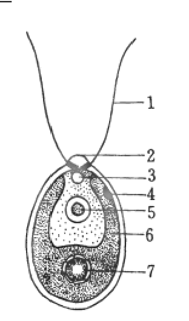

## 填空题

1\. 各门藻类的色素主要有四大类，分别是<u>叶绿素</u>，<u>胡萝卜素</u>，<u>叶黄素</u>和<u>藻胆素</u>。
2\. 藻类的繁殖方式基本上包括<u>营养生殖</u>，<u>无性生殖</u>，<u>有性生殖</u>和<u>接合生殖</u>。
3\. 硅藻门主要分为　　中心硅藻纲　　和　　羽纹硅藻纲　　两大类。
4\. 请写出甲藻板式 Po, 3′, 4″, 2a, 4‴, 3″‴，<u>1 个顶孔板，3 个顶板，4 个沟前板，2 个前间插板，4 个沟后板，3 个底板</u>。
5\. 甲藻纲分为哪两个亚纲:　　<u>横裂甲藻亚纲</u>　　和　　<u>纵列甲藻亚纲</u>。
6\. 下图所示藻类属绿藻门，其中 1，3，4，5，7 分别代表什么？

1：　　<u>鞭毛</u>　　，3：　　<u>伸缩炮</u>　　，4：　　<u>眼点</u>　　，5：　　<u>细胞核</u>　　，7：　　<u>蛋白核</u>　　。
7\. 绿藻门包括哪两个纲:　　<u>绿藻纲</u>　　，　　<u>接合藻纲</u>　　。

## 选择题

1\. 下列不属于海链藻属的是（B）

| A | B | C | D |
| --- | --- | --- | --- |
| ![[选择1A.png\|170]] | ![[选择1B.png\|100]] | ![[选择1C.png\|78]] | |

2\. 下列哪个属于角毛藻（C）

| A | B | C | D |
| --- | --- | --- | --- |
| ![[选择2A.png\|85]] | ![[选择2B.png\|85]] | ![[选择2C.png\|85]] | ![[选择2D.png\|85]] |

3\. 下列不属于中心硅藻纲的是（C）
A. 角毛藻　　B. 根管藻　　C. 双壁藻　　D. 盒型藻
4\. 下列不属于横裂甲藻亚纲的是（ D ）
A. 翅甲藻　　B. 夜光藻　　C. 裸甲藻　　D. 原甲藻
5\. 下列那种藻类会产生毒素（ B ）
A. 飞燕角藻　　B. 亚历山大藻属　　C. 意大利直链藻　　D. 骨条藻
6\. 下列哪种藻蛋白质含量较高（ C ）
A. 空球藻　　B. 实球藻　　C. 小球藻　　D. 栅藻
7\. 下列藻类中哪种属于真定型群体藻类 （ D ）

| A | B | C | D |
| --- | --- | --- | --- |
| ![[选择7A.png\|165]] | ![[选择7B.png\|170]] | ![[选择7C.png\|150]] | ![[选择7D.png\|140]] |

8\. 下列不同目的藻类中具有帽壳结构的是（C）
A. 绿球藻目　　B. 刚毛藻目　　C. 鞘藻目　　D. 团藻目
9\. 蓝藻淀粉遇碘会产生的颜色反应是（B）
A、紫黑色　　B、淡红褐色　　C、蓝色　　D、不反应
10\. 绿藻门的细胞壁主要构成成分是（C）
A、纤维素　　B、硅质　　C、果胶质　　D、木质素
11\. 蓝藻细胞壁上含有（C），是蓝藻区别于其他藻类的特征之一。
A 纤维素　　B 果胶质　　C 粘质缩氨肽　　D 碳酸钙
12\. 下列哪种藻类无蛋白核（A）
A 金藻　　B 甲藻　　C 隐藻　　D 绿藻

## 判断题：

（×）1.浮游植物就是浮游在水中的藻类。
（√）2. 骨条藻科是属于中心硅藻纲。
（×）3. 甲藻都具有细胞壁结构。
（√）4. 绿藻特有的生殖方式是接合生殖。
（√）5. 团藻是植物从群体进化到多细胞的过渡类型藻类。
（√）6. 刚毛藻的生活史中有同形世代交替。
（√）7. 蓝藻细胞结构简单，没有细胞核，属于原核生物。

## 简答题

**1.海洋浮游植物的基本特征有哪些?**
答：1、低等植物，分布甚广，绝大多数生活于水中；
2、具有叶绿素，整个藻体都有吸收营养，进行光合作用，一般自养生活；
3、生殖单位是单细胞的孢子或合子；
4、生活史中没有在母体内孕育着具有藻体雏形的过程。不开花结实。
5、是无胚具叶绿素的自养叶状体孢子植物（不能产生种子）

**2.硅藻的繁殖方式有哪几种，各有什么特诊?**
答：1. 营养生殖（细胞分裂）：硅藻最普遍的一种繁殖方式，开始时原生质略膨大，然后核进行分裂，原生质也一分为二，两核同时分别靠近上下两壳，每一半壳各自长出一个新的下壳，形成新个体，刚形成壳薄，以后逐渐增厚，直至与母壳相等为止。
2\. 复大孢子生殖：当细胞分裂到一定大小后，在某种环境下，可产生一种孢子，以恢复到原来大小，增强生命力，这种孢子称复大孢子。
3\. 无性生殖：① 由营养细胞的两壳直接脱开，原生质裸出，继续长大，近似球形，成为复大孢子，体积增大到正常时停止，分泌细胞壁，形成新个体。
② 在环壳的侧部发生一个小的椭圆形的小孔，细胞内容物通过小孔流出壳外形成球状，附着于孔部，成为球块，形成一个复大孢子，然后长出新的细胞壁
4\. 有性繁殖：由两个细胞各自进行减数分裂产生两个配子，含有两个核，其中一个核消失。不同细胞产生的配子彼此成对结合，成为两个复大孢子，孢子萌发，形成新个体。

**3.中心硅藻纲和羽纹硅藻纲的特征是什么?**
答：中心硅藻纲：花纹呈同心的反射状排列，不具壳缝或假壳缝。
　　羽纹硅藻纲：花纹左右对称，呈羽状排列，具壳缝或假壳缝。

**4.简述绿藻门的主要特征**
1\. 细胞壁，内层：纤维素，外层：果胶质表面平滑或具颗粒、孔纹、瘤、刺毛等；
2\. 色素：β-胡萝卜素，叶黄素等（与高等植物相似），色素体：杯、盘、星、板、网、螺旋带状等；
3\. 贮存物质：淀粉，颗粒状；4. 鞭毛：2 条，顶生，等长；少数 1,4,6,8 条；
5\. 伸缩泡：2 个；6. 眼点：1 个，橘红色，细胞前侧面。
